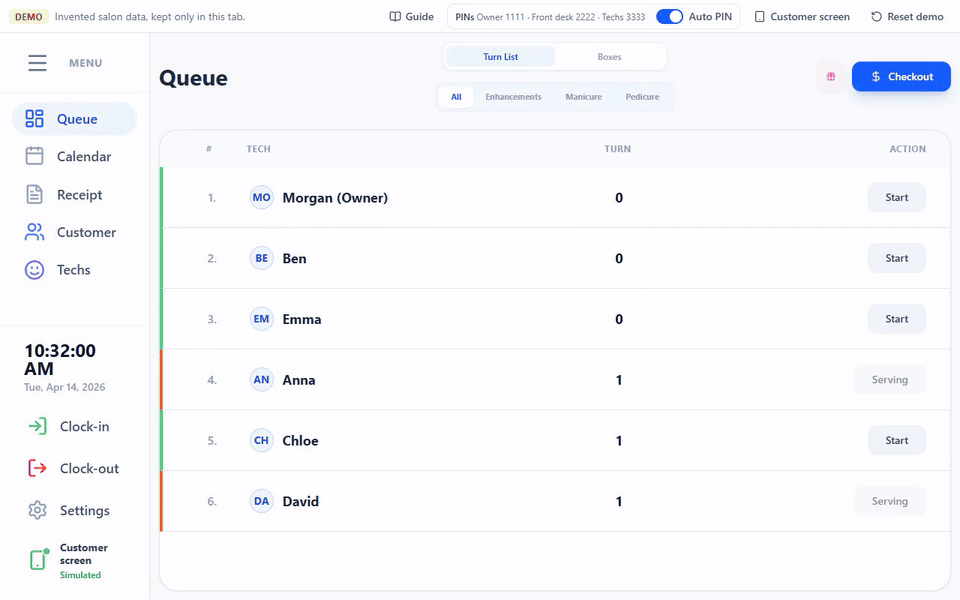
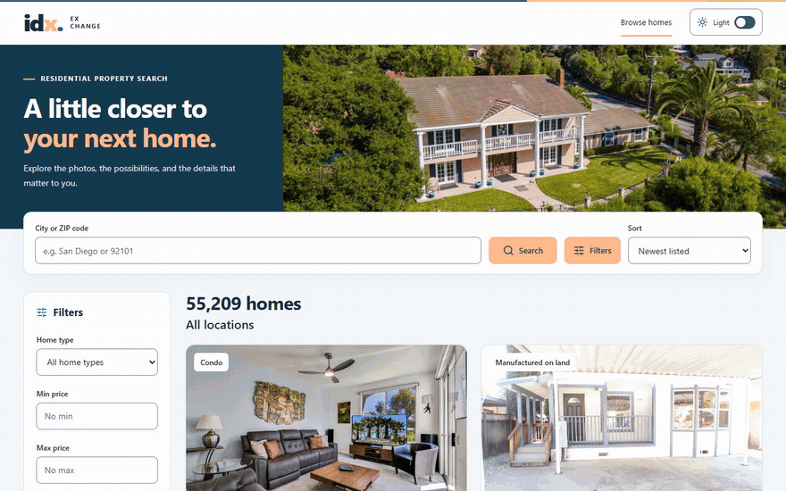
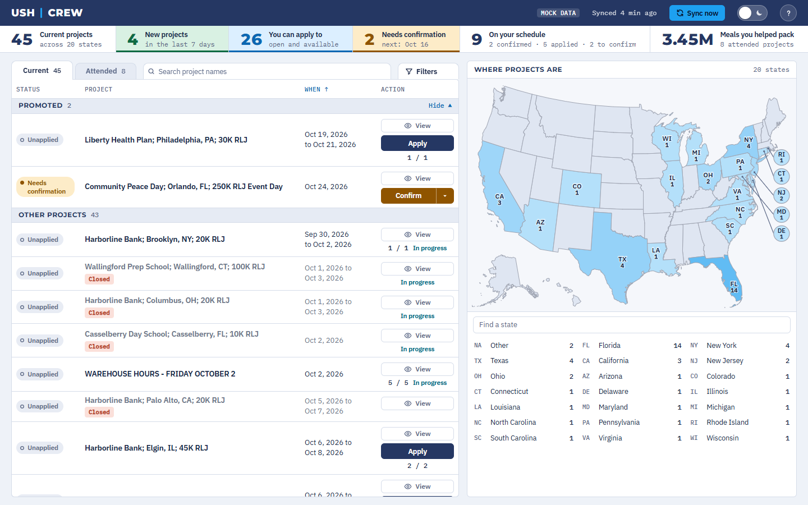
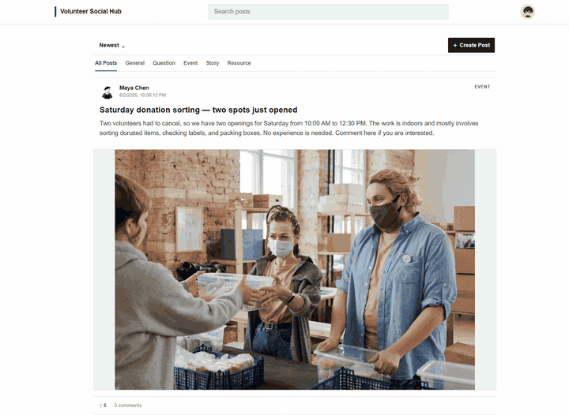

# Minh Thien Pham

Computer Science student at UCF building full-stack and desktop applications, from offline
software a small business runs every day to deployed web apps with tested, layered backends.
Looking for **software engineering internships and new-grad roles**.

[Portfolio](https://minhthienpham.me) · [LinkedIn](https://www.linkedin.com/in/minthp/) · [Email](mailto:phamminhthien065@gmail.com)

## Featured projects

### Nail Salon POS · in daily use at a nail salon

An offline point-of-sale desktop app that runs a nail salon's front desk: technician turn
rotation, checkout, payroll, loyalty and gift cards, with a customer check-in tablet on the salon
Wi-Fi.

- **Real users:** built for one salon and used there every day.
- **Business rules in code:** fair turn rotation with three turn types, one ticket split across
  technicians, mixed payments and tips, commission payroll and profit reporting.
- **Engineering:** Clean Architecture modules with ports and repositories, atomic SQLite
  transactions, versioned migrations with verified backups, Zod validation at every IPC boundary,
  and architecture tests that fail the build when a dependency points the wrong way.

**Electron · React · TypeScript · SQLite · Express + WebSocket · Vitest**

[Live demo](https://minh-nail-pos.vercel.app) · Source code: private repository, walkthrough on request

### [IDX Exchange](https://github.com/MinhThien-Pham/IDX-exchange) · property search over 55,000 listings

A residential property search built for the IDX Exchange Software Development Engineer
Internship. Visitors filter about 55,000 MLS listings by location, budget, rooms and home type,
then open a listing for photos, facts and open houses.

- **Full stack, deployed:** React web app and Express API on Vercel, PostgreSQL on Neon, with
  shared Zod contracts validating every request and response.
- **Data:** a streaming importer normalizes the MLS export into PostgreSQL; indexed queries return
  filtered, sorted pages in about 200 ms in production.
- **Quality:** modular Clean Architecture API, CI with PostgreSQL integration tests, Playwright
  end-to-end tests with automated accessibility checks, and coverage gates.

**TypeScript · React · Express · PostgreSQL · Drizzle · Playwright · Vercel**

[Live demo](https://idx-exchange-three.vercel.app) · [Source code](https://github.com/MinhThien-Pham/IDX-exchange)

### USH Crew · Chrome extension for volunteer project signup

A Manifest V3 Chrome extension that puts every current U.S. Hunger project on one page: your
status in each, open spots and a map, with apply, confirm and withdraw in place.

- **Privacy by design:** no developer server and no analytics; the extension reads nothing until
  the user consents, and never stores a password or token.
- **Product depth:** URL-shareable filters, a US map with per-state counts, a work-history tab and
  a guided tour.
- **Engineering:** the extension's four separate execution contexts (dashboard, content script,
  page-world script, background worker) with a message protocol between them; project
  descriptions are sanitized with DOMPurify; unit tests with Vitest.

**React 19 · TypeScript · Vite · Chrome Extension MV3 · Vitest**

[Live demo with sample data](https://ush-crew.vercel.app) · Source code: private repository, walkthrough on request

### [Volunteer Social Hub](https://github.com/MinhThien-Pham/Volunteer-Social-Hub)

A volunteer community forum for sharing opportunities, experiences, questions and resources,
built as the CodePath WEB102 final project.

- **Accounts and content:** sign-up and login, public profiles, categorized posts, up to six
  ordered images per post in a custom carousel, comments, search, sorting and upvotes.
- **Security in the database:** Row Level Security and least-privilege grants, upvotes through a
  scoped RPC, and storage upload policies limited to the user's own paths.
- **Serverless:** the app talks directly to Supabase, with no custom backend server.

**React · Vite · Supabase (PostgreSQL, Auth, Storage) · Netlify**

[Live demo](https://volunteer-social-hub.netlify.app/) · [Source code](https://github.com/MinhThien-Pham/Volunteer-Social-Hub)

### [MLC-CLI Build Service](https://github.com/MinhThien-Pham/fastapi-mlc-docker)

A FastAPI and Docker service that turns an LLM model build workflow into repeatable APIs for
model preparation, quantization, compilation, runtime checks and local chat.

- **Reproducible builds:** the upstream build tool is pinned to a verified commit inside the
  Docker image, and generated artifacts persist across container restarts.
- **Observable long jobs:** build, quantize and compile steps stream progress live over
  Server-Sent Events.
- **Guardrails:** typed request schemas, status checks and tests around the API.

**Python · FastAPI · Docker · CUDA · Server-Sent Events**

[Source code](https://github.com/MinhThien-Pham/fastapi-mlc-docker) · [API reference](https://github.com/MinhThien-Pham/fastapi-mlc-docker/blob/main/docs/API_ENDPOINTS.md)

## Skills

| Area | Tools |
| --- | --- |
| Languages | TypeScript, JavaScript, Python, C, SQL |
| Frontend | React, Vite, Tailwind CSS, TanStack Query, Chrome extensions (MV3) |
| Backend | Node.js, Express, FastAPI, Electron |
| Data | PostgreSQL, SQLite, Supabase, Drizzle ORM |
| Testing and delivery | Jest, Vitest, Playwright, GitHub Actions, Docker, Vercel |
